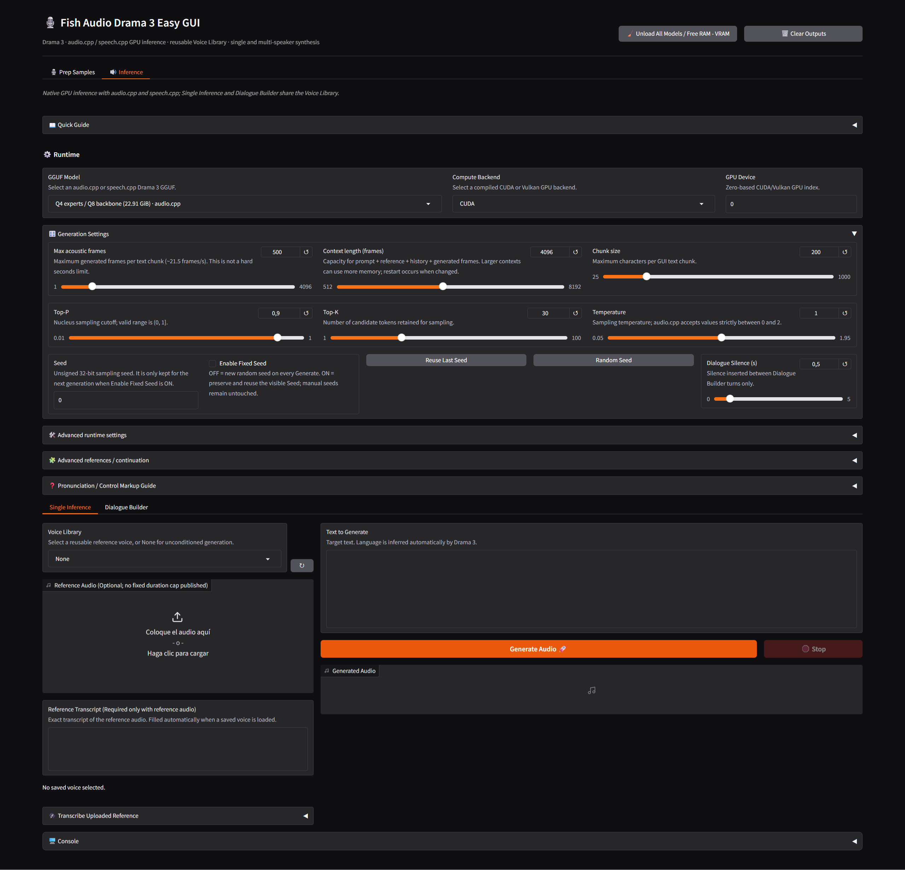
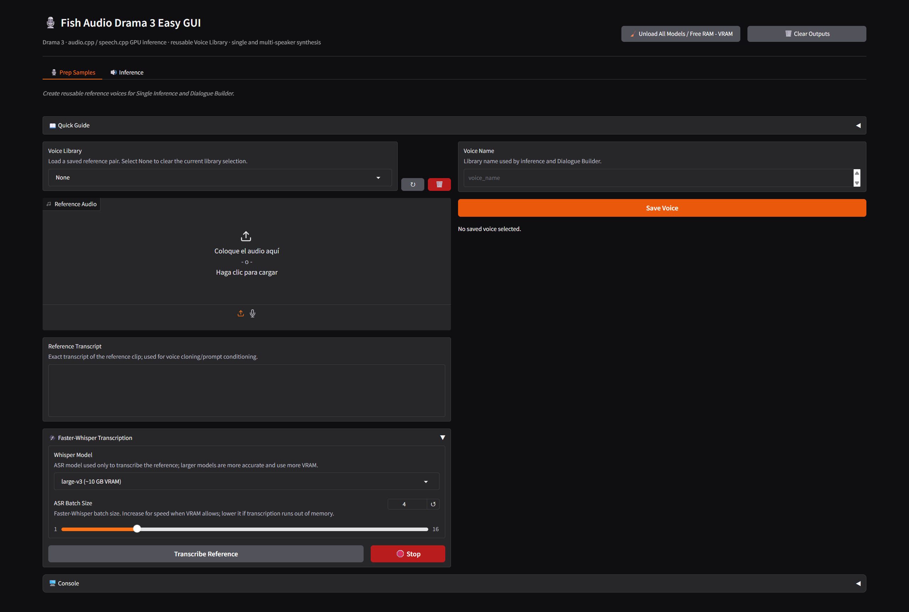

# Fish Audio Drama 3 Easy GUI

Windows GUI for generating speech with Fish Audio Drama 3. It provides Single Inference, Dialogue Builder, saved voice references, optional reference transcription, and configurable text chunking. Inference uses CUDA or Vulkan GPU runtimes.



## Install

Requirements:

- Windows 10 or 11 and Git for Windows.
- Visual Studio 2022 C++ Build Tools when an audio.cpp server needs to be built.
- CUDA Toolkit with `nvcc` for the audio.cpp CUDA backend.
- Internet access and enough disk space for the Vulkan SDK when it is not already present in `.runtime`.
- A Vulkan-capable GPU driver. `speech.cpp` on Windows uses Vulkan.

Run:

```cmd
install.bat
start.bat
```

The installer prepares the Python environment, installs the speech.cpp 0.8.8 Vulkan runtime, downloads the official LunarG Vulkan SDK into `.runtime` when needed, and builds any missing audio.cpp server targets for the GPU backends it can configure. Existing Drama 3 server builds and a complete local Vulkan SDK are reused. Logs are written to `.runtime\logs`.

### Vulkan SDK setup

When no complete SDK is already present in `.runtime\vulkan-sdk`, the installer fetches the current Windows SDK and its SHA-256 metadata from LunarG, verifies the download, and installs the full SDK under `.runtime\vulkan-sdk\<version>`. It uses LunarG's `copy_only=1` mode, which keeps SDK installation changes inside the project instead of modifying system PATH or the registry. Later runs reuse a complete local SDK. A Vulkan-capable GPU driver is still required at runtime; the installer may copy the driver's `vulkan-1.dll` into `.runtime\vulkan\bin` when available.

## Models and runtimes

Choose a GGUF only with its matching runtime:

| GGUF | Runtime | Size |
|---|---|---:|
| Q4 experts / Q8 backbone | audio.cpp | 22.91 GiB |
| Q3 experts / Q8 backbone | audio.cpp | 18.93 GiB |
| Q2 experts / Q8 backbone | audio.cpp | 15.88 GiB |
| Q4 experts / Q4 backbone | audio.cpp | 21.78 GiB |
| `Drama-35B-A3B-v3-Q4_K.gguf` | speech.cpp 0.8.8+ | 20.79 GB |

The audio.cpp GGUFs are downloaded from [Jmica/Drama-3-GGUF](https://huggingface.co/Jmica/Drama-3-GGUF). The Sakasegawa GGUF is downloaded from [sakasegawa/drama-3-GGUF](https://huggingface.co/sakasegawa/drama-3-GGUF) and is supported here through speech.cpp. The two GGUF layouts are not interchangeable. Models download on first use.

The audio.cpp backend can use CUDA or Vulkan, depending on the installed runtime. On Windows, the speech.cpp backend uses Vulkan. Select a GPU device supported by the chosen backend. For Sakasegawa, CPU expert execution is disabled; generation fails if the GPU cannot hold the required model state.

## Prep Samples



Use this tab to create and manage reusable voice references for Single Inference and Dialogue Builder.

1. **Load or record reference audio.** Choose an existing voice in **Voice Library**, or upload a WAV / record a clip with **Reference Audio**. Keep the clip clear and dry, with the speaker saying only the words you want to transcribe. Shorter clips leave more model context available for generated speech. 
2. **Enter the transcript.** In **Reference Transcript**, type exactly what is spoken in the clip. The transcript is used with the audio when cloning the voice.
3. **Optionally bootstrap the transcript.** Open **Faster-Whisper Transcription**, choose a Whisper model and batch size, then click **Transcribe Reference**. Language detection is automatic. Review and correct the result before saving; use **Stop** to cancel transcription.
4. **Save the voice.** Enter a name in **Voice Name** and click **Save Voice**. The saved audio and transcript become available in both inference workflows.
5. **Manage saved voices.** Select a voice from **Voice Library** to load it into the tab. Click **↻** to refresh the list after changes or **🗑️** to delete the selected voice. Choose **None** to clear the selection without deleting the saved voice.

## Inference

- **Single Inference** generates from text and an optional WAV reference with its transcript.
- **Dialogue Builder** generates every filled turn as a separate inference. The runtime is stopped and memory is reclaimed between turns; each turn can use a saved voice or the model's voice.
- **Chunking Rule, Chunk Size, and Chunk Gap** split long text into manageable requests and insert optional pauses.
- **Max acoustic frames** controls the audio.cpp generation limit per request. It is not a direct duration setting.
- Reference transcription uses Faster-Whisper. 

Drama 3 supports speaker markers `<|speaker:0|>` through `<|speaker:15|>` and bracketed delivery cues such as `[laughs]` or `[sighs]`. See the [official model card](https://huggingface.co/fishaudio/drama-3) for prompt examples.

> [!Warning]
Reference audio around 30 seconds to over a minute can cause extreme slowdowns from aggressive RAM offloading, or a CUDA out-of-memory error.

## License

Drama 3 weights are subject to the [Fish Audio Community License](https://huggingface.co/fishaudio/drama-3/blob/main/LICENSE). Review the applicable model and runtime licenses before use or redistribution.

## References

- [Fish Audio Drama 3 model card](https://huggingface.co/fishaudio/drama-3)
- [Jmica Drama 3 GGUF for audio.cpp](https://huggingface.co/Jmica/Drama-3-GGUF)
- [Sakasegawa Drama 3 GGUF for speech.cpp](https://huggingface.co/sakasegawa/drama-3-GGUF)
- [audio.cpp Windows build guide](https://github.com/0xShug0/audio.cpp/blob/main/docs/build/windows.md)
- [speech.cpp](https://github.com/nyosegawa/speech.cpp)
- [LunarG Vulkan SDK](https://vulkan.lunarg.com/)
